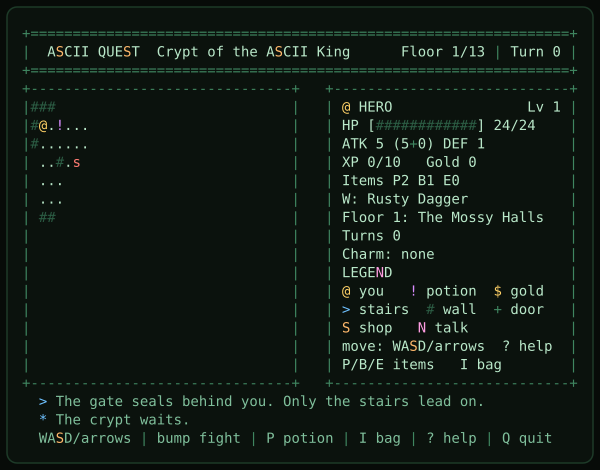
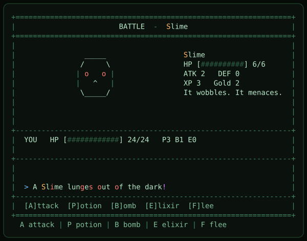
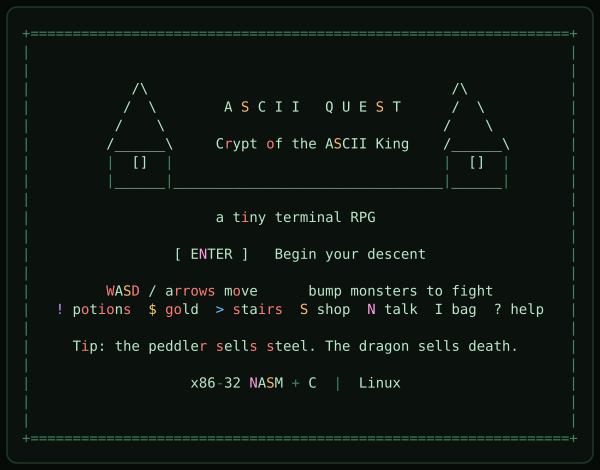

# ASCII QUEST

### Crypt of the ASCII King

A tiny **32-bit x86 terminal RPG** written in **NASM + C** for Linux.

No game engine. No ncurses. No assets. Just `int 0x80`, ANSI escapes, and 66 columns of ASCII.

[](https://github.com/Neatsuki/ascii-quest/actions/workflows/ci.yml)




[中文说明](README.zh-CN.md) · [Build](#build) · [Controls](#controls) · [Architecture](#architecture)

---

## What is this?

You are a hero with a rusty dagger, 24 HP, and a bad idea: descend into a 13-floor crypt,
get stronger, and kill the dragon at the bottom.

This is a complete small RPG in the old-school terminal sense:

- **13 hand-built floors**, from the Mossy Halls to the Dragon's Maw
- **14 enemy types** with distinct traits: poison, lifesteal, fireballs, dodging, armor-piercing, and a golem that skips turns
- **6 weapons**, **5 weapon affixes**, and **4 charm accessories**
- A shop on most floors, two NPC side quests, and a final boss that hits back
- **Fog of war** with Bresenham line-of-sight and remembered terrain
- **Deterministic seeds**, versioned binary saves, and an optional **procedural dungeon mode**
- A **73-check pty smoke suite** that drives the real game, not a mock

It is deliberately small, but it is not a toy demo: combat, progression, inventory,
quests, save/load, and random generation all work together.

---

## Quick start

Requires a 32-bit x86 Linux toolchain. On Debian/Ubuntu/WSL:

```bash
git clone https://github.com/Neatsuki/ascii-quest.git
cd ascii-quest
sudo apt install nasm gcc-multilib libc6-dev-i386
make
./rpg
```

Check that the result is a real 32-bit ELF:

```bash
file rpg
# rpg: ELF 32-bit LSB executable, Intel i386 ...
```

The terminal must be at least **70x24**. Something like Windows Terminal + WSL,
GNOME Terminal, or Alacritty at 100x30 or larger is ideal.

### CLI

```text
./rpg [options]

  --seed N       fix the RNG seed (reproducible maps and enemy behaviour)
  --floor N      start on floor 1..13 (development shortcut)
  --random       generate every floor procedurally
  --save PATH    file used by F5 and autosave
  --load PATH    load a save and start on the map
  --help         show help
```

Examples:

```bash
./rpg --seed 42
./rpg --floor 13
./rpg --random --seed 7
./rpg --save /tmp/ascii-quest.sav
```

---

## Controls

| Key | Action |
|-----|--------|
| `WASD` / arrow keys | Move |
| Walk into a monster | Attack |
| Walk into `S` | Open the shop |
| Walk into `N` | Talk to an NPC |
| `1`–`5`, `0` in shop | Buy potion / bomb / elixir / next weapon / charm / leave |
| `I` | Open backpack |
| `1`–`6` in backpack | Equip an owned weapon |
| `A` in backpack | Cycle owned charms |
| `P` / `B` / `E` | Use potion / bomb / elixir |
| `A` / `Enter` in combat | Attack |
| `F` in combat | Flee (55%; the dragon cannot be fled) |
| `F5` / `F9` | Save / load |
| `Space` | Wait one turn |
| `?` | Help |
| `Q`, then `Y` | Quit |
| `R` | Restart after death or victory |

Dialogue: `Enter` / `Space` for the next page, `1` to accept or claim a quest,
`0` / `Esc` to leave.



---

## Build

```bash
make            # build rpg
make run        # build and run
make test       # build + run the pty smoke suite
make clean
```

The build is intentionally 32-bit:

```make
CFLAGS  := -m32 -march=i386 -std=gnu11 -O2 -Wall -Wextra \
           -fno-pie -fno-stack-protector -fno-asynchronous-unwind-tables
LDFLAGS := -m32 -no-pie -Wl,-z,noexecstack
```

It is a normal dynamically linked 32-bit libc program. The interesting part is
that low-level terminal I/O and the PRNG live in NASM.

---

## Project layout

```
.
├── Makefile
├── README.md
├── README.zh-CN.md
├── LICENSE
├── .github/workflows/ci.yml
├── screenshots/
│   ├── map.svg
│   ├── combat.svg
│   └── title.svg
├── src/
│   ├── game.h          shared types, constants, prototypes
│   ├── data.c          monsters, weapons, affixes, accessories, NPCs, 13 maps
│   ├── ui.c            terminal raw mode, output buffer, key parser
│   ├── render.c        map / combat / shop / backpack / dialogue / title
│   ├── world.c         terrain, visibility, movement, pickups, floor changes
│   ├── dungeon.c       procedural floor generation for --random
│   ├── combat.c        turn-based combat, traits, poison, level-ups
│   ├── inventory.c     supplies, weapons, affixes, charms, shop
│   ├── npc.c           dialogue pages and quest state machine
│   ├── save.c          versioned binary save/load
│   ├── main.c          CLI, event loop, per-mode key dispatch
│   └── asmfuncs.asm    NASM: write/read/PRNG/fill32/PRNG state
└── tests/
    └── smoke_test.py   pty smoke tests with a tiny ANSI screen emulator
```

## Architecture

Everything is split by responsibility. `Game` is the single piece of mutable
state; static content lives in `data.c`; screens only read state; `main.c`
dispatches keys by mode.

| File | Responsibility |
|------|----------------|
| `game.h` | Public types and `Game` state |
| `data.c` | Static tables only, no rendering or input |
| `ui.c` | Raw terminal, buffered output, `read_key()` including F5/F9 |
| `render.c` | Draws screens, never mutates the game |
| `world.c` | Map loading, FOV, movement, pickups, stairs |
| `dungeon.c` | Rooms, corridors, per-floor spawns for `--random` |
| `combat.c` | Player/enemy turns, traits, poison, loot, XP |
| `inventory.c` | Gear stats, shop transactions, backpack actions |
| `npc.c` | Dialogue pages and quest state |
| `save.c` | Explicit field-by-field save format with validation |
| `main.c` | CLI, main loop, mode dispatch |
| `asmfuncs.asm` | 32-bit `int 0x80` wrappers and xorshift32 |

### Why NASM?

`src/asmfuncs.asm` provides seven cdecl functions:

| Function | Implementation |
|----------|----------------|
| `asm_write(fd, buf, count)` | `eax=4` |
| `asm_read(fd, buf, count)` | `eax=3` |
| `asm_random()` | xorshift32, returns 32-bit value |
| `asm_srandom(seed)` | Seeds the PRNG; 0 becomes a non-zero constant |
| `asm_fill32(dst, value, count)` | `rep stosd` for clearing map/visibility arrays |
| `asm_get_random_state()` | Read xorshift32 state for saving |
| `asm_set_random_state(state)` | Restore xorshift32 state when loading |

C handles game logic and screen composition. The assembly layer handles the
parts where stdio buffering would get in the way: unbuffered terminal I/O and
the deterministic PRNG.

---

## How it plays

- **Movement is bump-to-fight.** There is no separate attack key on the map.
- **Fog of war** uses a radius-5 Bresenham line check; explored tiles stay in memory.
- **Enemies** within 6 tiles pursue with 65% probability. The dragon guards its floor and does not chase.
- **Damage** is `attack - defense + rand(0..2)`, with a 12% crit chance.
- **Monster traits** are data-driven in `ENEMY_TRAITS[]`: dodge, drain, poison, firebolt, slow, pierce.
- **Poison** lasts 3 turns and ticks before your action, showing `PSN` in the combat HUD.
- **XP** needed for the next level is `10 + (level - 1) * 15`; multiple level-ups can happen at once.
- **Supplies** share `supplies[]` with caps 9/5/3. Bombs deal `25 + rand(8)` and ignore defense.
- **Weapons** are a bitmask collection; the shop always sells `best_weapon + 1`.
- **Affixes** are rolled when a weapon is bought. `player_atk/def/crit/lifesteal` in `world.c` is the single source of truth for gear stats.
- **Elixir buffs** are cleared by `start_combat`; they only last one fight.
- **Saves** are explicit fields, not a struct dump. The RNG state and generated map are included, so a loaded random run continues exactly.
- **Rendering** writes into a 64 KB buffer and flushes once per frame, which keeps the terminal from flickering.
- **Terminal restore** happens on normal exit and via `atexit`; `Q` follows that path.

---

## Tests

```bash
make test
```

`tests/smoke_test.py` launches the real binary under a pty, sets the window size,
sends keystrokes, and checks the screen with a small ANSI emulator. No `pyte`,
no mocking framework.

The suite covers:

- `--help` and invalid options
- title → map transition, panel and borders
- movement and redraw
- help open/close
- backpack, affix/charm rows, locked-weapon messages
- quit confirmation and cancel
- all 13 floors, `Floor N/13` headers, final-floor entry
- `--random` floors
- F5 save, `--load`, F9 in-process reload, turn restoration
- NPC dialogue, quest pages, and accepting a quest
- exit code, terminal restoration, cursor restoration

---

## Notes and limitations

- This is a **32-bit x86 Linux** program. It will not build or run as a 64-bit binary; that is the point of the NASM part.
- It needs a real terminal of at least 70x24. It is not a browser game.
- The map is 31x15 with a 66x23 UI; the art is deliberately compact.
- There is no sound, mouse input, or networking.
- The random dungeon generator is intentionally simple: 5–7 rooms, L-shaped corridors, guaranteed connectivity.

---

## License

MIT. See [LICENSE](LICENSE).



---

## 这个分支：第 14 层与 ASCII 国王

本分支在原作者版本上做了三件事（详见 `docs/reverse-notes.md` 与 `docs/script-02-ascii-quest.md`）：

1. **加了第 14 层** `The Throne of Ash`（前厅 → 大厅 → 王座厅，柱子做掩体）；
2. **加了新 Boss** `The ASCII King`：460 HP / ATK 24 / DEF 11，每三回合放一次雷，不能逃跑；
3. **改了封印规则**：本层还有活着的 Boss 就锁楼梯（原来杀龙即通关，现在杀王才通关）。

另有 `bot/`（自动驾驶机器人）与 `video/`（76.9s 的成片）。

两次通关：原版 Lv15 / 913 金 / 1518 回合；本分支 Lv18 / 1101 金 / 2360 回合。
